# RustyBar

A status bar for macOS, written in Rust: one process that reads everything in-process and is
driven by events, with Core Animation for the animations and popups that you can build out of
real components (grids, scrolling lists, sliders, toggles, progress bars) in Lua.

At rest, with every built-in widget in the bar, it uses about **18 MB** of memory and **~0.1%
CPU** in a single process, and draws its first frame in **about 50 ms**. For comparison, the
SketchyBar setup it replaces took about 176 MB in 15 processes and ~1.3% CPU, and started some 150
processes a minute.

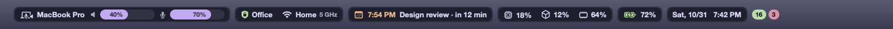

## Widgets

| Widget | What it shows | Popup |
| --- | --- | --- |
| `apple` | The Apple logo | The Apple menu: About This Mac, Force Quit, Sleep, Restart, Shut Down, Lock Screen, Log Out, and last Dotfiles Settings (see [Settings window](#settings-window)) |
| `aerospace` | [AeroSpace](https://github.com/nikitabobko/AeroSpace) workspaces with the icons of their windows in on-screen order, the focused one under a sliding highlight, the binding mode | — (clicks switch workspace, focus a window, leave the mode) |
| `front_app` | The app in front | — |
| `now_playing` | What Music or Spotify is playing, or any app with `other_apps`: the cover, the title and the artist, dimmed while paused (`paused = false` hides it then); hidden when nothing plays. A long title takes the room left beside it, and scrolls while it plays if it still doesn't fit. Under the mouse it grows down with the progress and ⏮ ⏯ ⏭. In the center by default | A player in the colors of the cover: the cover, title, artist and album, a bar to seek with the time gone and left, shuffle, previous, play/pause, next, repeat, the app's own volume, favorite (Music) and the app; a switch between the apps when more than one has a track |
| `system` | CPU, GPU and memory, colored by load and memory pressure | A dashboard: CPU and GPU with the last minute as a graph; memory split into app, wired and compressed; each disk with its used, available and purgeable space (a click opens it in the Finder); the apps that use the most CPU, GPU or memory; Activity Monitor and Storage settings |
| `battery` | The charge, with an icon for its state | A dashboard: the state with a bar of the charge that marks the limit, the Charge Limit (macOS 26.4+) as a slider with its steps and Charge to Full Now; tiles for the maximum capacity and the condition, the cycles against the ones the battery is made for, the temperature and the power the Mac draws; the adapter while one is plugged in; Battery settings |
| `clock` | Date and time in the language and format of your Mac | A calendar that scrolls through the months without end; a click on a day opens it in Calendar |
| `audio` | The output and the input in use, with the battery of Bluetooth devices and a slider with the volume of each (`sliders = false` hides them), the first thing to go when the bar has no room; the Mac's own speakers and microphone, or both halves of a headset, show as one | A dashboard: the output and input volume, each with its level and a slider; tiles for the devices to switch to and for the paired Bluetooth headphones and speakers to connect or disconnect |
| `network` | The VPN, then the Wi-Fi network and its band, or Ethernet; the icon turns yellow or red when there's no connection | A dashboard: on top Wi-Fi on and off with the nearby networks to join as tiles (the password is asked once and kept in the keychain) and the wired services with a switch; under them the connection with its signal (or Ethernet's link speed), download and upload with the last 30 seconds as a graph and the VPN; then Details, closed until clicked: on Wi-Fi the link rate and generation, channel, band and width, signal-to-noise and security, then local and public IP, router with its ping, provider, DNS, MAC address and IPv6, each copied with a click |
| `events` | Today's next event from the Mac's calendars: its time, colored as it gets close, the title and a countdown | Today's events; a click joins the Google Meet call or shows the event in Calendar |
| `notifications` | Two counts: the Dock badges of the apps you choose and new RustyBar crash reports (green), Homebrew updates (red) | The badged apps and crash reports to open, the packages to update one by one or all at once |
| `home` | [Home Assistant](https://www.home-assistant.io): its logo with how many devices are on, and the 3D printer's progress while it prints | A dashboard of tiles: lights and plugs (with brightness), blinds, climate (modes and − target +), vacuum, the 3D printer, scripts and scenes as chips |
| `claude` | How much of the Claude plan each account has used: the 5-hour session and the week | For each account its plan and two tiles, the session and the week, with a bar, when they reset and how long until then; how old the numbers are, ↻ to read them again, log in and log out; the usage page on claude.ai |
| `docker` | How many containers run, red when one is unhealthy; hidden while Docker is off | A dashboard: the engine and what the containers use; every container, by Compose project, with its state, CPU, memory, image, ports (links to localhost) and uptime, and buttons to start, stop, restart and remove it (a project's at once too); disk usage of images, containers, volumes and build cache, each cleaned up with a click, unused networks and a system prune; Docker Desktop |

Each widget with its popup, on made-up data (see below):

<table>
<tr>
<td align="center" valign="top">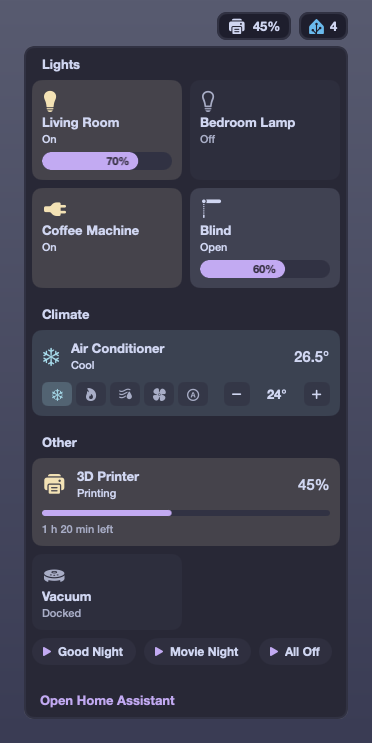<br><code>home</code></td>
<td align="center" valign="top">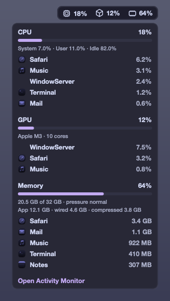<br><code>system</code></td>
</tr>
<tr>
<td align="center" valign="top">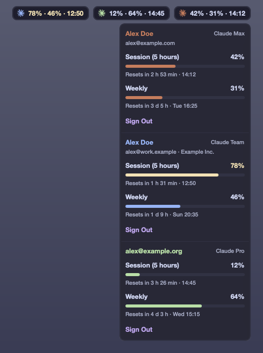<br><code>claude</code></td>
<td align="center" valign="top">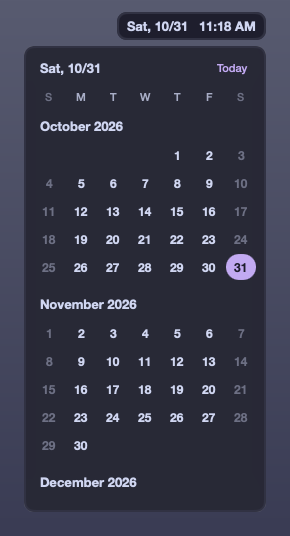<br><code>clock</code></td>
</tr>
<tr>
<td align="center" valign="top">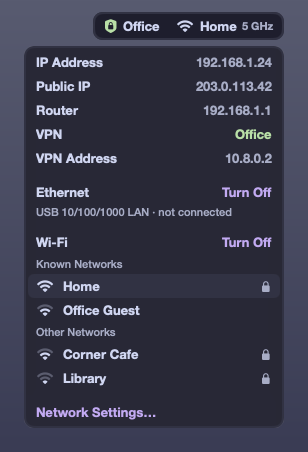<br><code>network</code></td>
<td align="center" valign="top">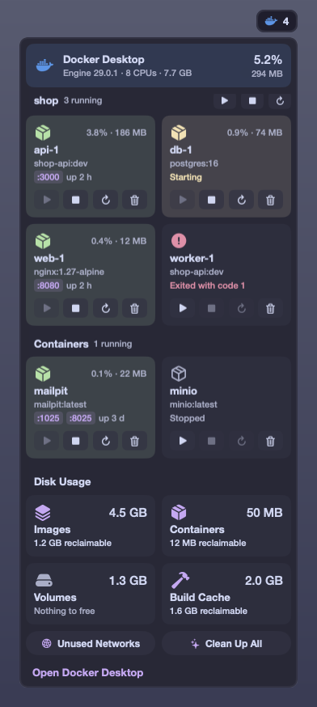<br><code>docker</code></td>
</tr>
<tr>
<td align="center" valign="top">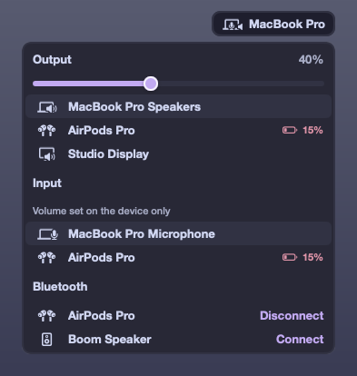<br><code>audio</code></td>
<td align="center" valign="top">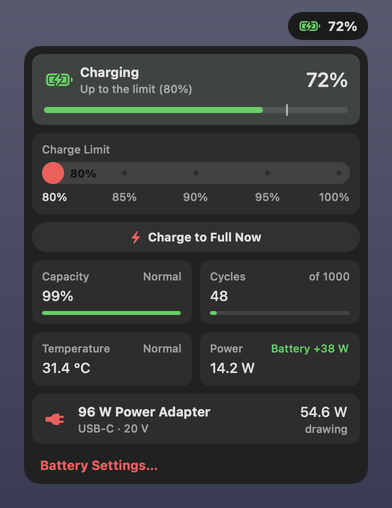<br><code>battery</code></td>
</tr>
<tr>
<td align="center" valign="top">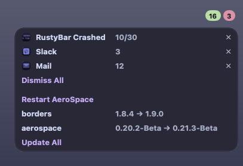<br><code>notifications</code></td>
<td align="center" valign="top">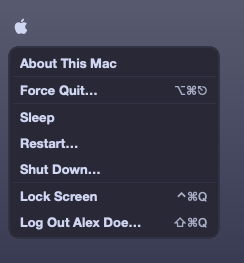<br><code>apple</code></td>
</tr>
<tr>
<td align="center" valign="top">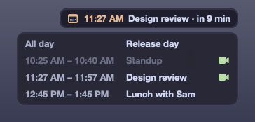<br><code>events</code><br><br>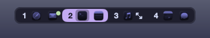<br><code>aerospace</code><br><br>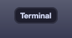<br><code>front_app</code></td>
<td align="center" valign="top">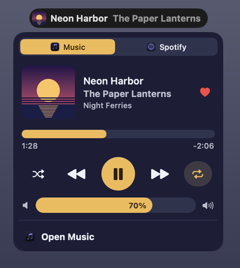<br><code>now_playing</code></td>
</tr>
</table>

Widgets don't poll what macOS can tell them: AeroSpace events come from its socket, the battery
from IOKit and PowerUIAgent notifications, the front app from NSWorkspace, what plays from the
notifications of Music and Spotify, the sound from CoreAudio
listeners, the network from the System Configuration store, the calendars from EventKit, Home
Assistant from its WebSocket API, Docker from the `/events` stream of its Engine API, the clock
from a timer aligned to the minute. What has no event is read in-process on a timer: CPU, GPU and
memory every 2 seconds, the Dock badges every 2 seconds (through Accessibility), and only while
their popups are open the network's traffic and Wi-Fi link every second and, with its details
open, a ping to the router every 5, the battery's temperature and power every 2 seconds, and the
disks every 10. The bar is redrawn only when a value changes.

A few things still run a process: `brew outdated` every hour and on wake (only with `brewfile` or
`brew = true`), `system_profiler` for AirPods batteries and paired devices when the audio popup
opens and every 2 minutes while a Bluetooth device is in use, `system_profiler` for the battery
health at most once a day, when the battery popup opens, `curl` for the public IP and its provider
(from ipinfo.io) when the network popup's details open, and Claude Code (`claude auth status` and
`claude -p`, for each account) every 5 minutes, on wake, when the Claude popup opens and with ↻: it's the
only way to the plan's numbers. It asks for them without sending a message, so it doesn't use the
plan. The keychain is read and written through `security`, once for each secret. While the
settings window is open it runs as a second RustyBar process, which ends when it closes, and a
change to the borders starts `borders` with its new options if it's running. With `other_apps` of
`now_playing`, off by default, a `perl` process runs as long as the bar (see
[Now Playing](#now-playing)).

Until a widget has its first data, the bar shows its last known state, dimmed, or a shimmering
placeholder the very first time. A widget that fails shows an error pill; the rest of the bar
keeps working.

## Install

Requires macOS 13 or later and Rust (`brew install rustup && rustup-init`).

```bash
git clone https://github.com/Francesco-Rapetti/rustybar && cd rustybar
scripts/bundle.sh
cp -R target/RustyBar.app /Applications/
/Applications/RustyBar.app/Contents/MacOS/rustybar service install
```

`service install` adds a LaunchAgent that starts RustyBar at login and again if it ever crashes;
its log is `~/Library/Logs/rustybar.log`. `service uninstall` removes it.

macOS remembers permissions by code signature. With the default ad hoc signature it asks again
after every build; `scripts/signing-cert.sh` creates a local signing certificate once, and
`scripts/bundle.sh` uses it from then on (or set `RUSTYBAR_SIGN_IDENTITY` to a Developer ID).

RustyBar asks for each permission the first time a widget needs it:

| Permission | Widget | For |
| --- | --- | --- |
| Calendars | `events` | Today's events (at start) |
| Location | `network` | The nearby Wi-Fi networks and joining them (when its popup opens); the name of the current network doesn't need it |
| Bluetooth | `audio` | Connecting and disconnecting headphones and speakers (on the first click) |
| Accessibility | `notifications` | The Dock badges (at start, only with `apps`); without it a yellow `!` shows, whose popup asks again, and the rest of the widget works |
| Automation | `apple`, `clock`, `now_playing` | Restart, Shut Down and Log Out; showing a day in Calendar; for Music and Spotify, the position, the cover and the controls (when the popup opens or on a click); without it the bar still shows what plays |
| Local Network | `home`, `network` | Reaching a Home Assistant server on your network (at start); the ping to the router (when the network popup's details open), without which the rest works |

To keep the macOS menu bar out of the way, turn on *Automatically hide and show the menu bar* in
System Settings → Control Center.

## Configure

The config is `~/.config/rustybar/rustybar.toml`, written with every default and a comment for
each key on the first start (see [config/rustybar.toml](config/rustybar.toml)). Saving it, or any
widget in `~/.config/rustybar/widgets/`, reloads the bar, with the changes animated.

```toml
[theme]
preset = "catppuccin-mocha"
primary = "mauve"

[layout]
left = ["apple", "aerospace", "front_app"]
right = ["system", "battery", "clock"]

[widgets.clock_utc]   # a second clock, by name
type = "clock"
timezone = "UTC"
```

The default preset, `macos`, takes the system's colors: light or dark as the Mac is, with the accent
color of System Settings as `accent` (the default `primary`), and it follows them when they change.
Its pills are on Liquid Glass (macOS 26; a blur before): `pill_glass = "clear"` is the clear glass
of the Dock, which bends the light at its edges, with a veil of the background color under the
text so it stays legible on any wallpaper; `"regular"` is the frosted glass of the menus. Its popups
are frosted glass. The font is the system's (SF Pro) and the pills are capsules.

The other palettes of `preset`, each from the theme's own repository, have the pills on the
palette's `base`, with a border. With `glass = true` they're on Liquid Glass too, as `macos` is,
with a veil of the palette's `base` over the glass of the pills and the popups; the glass is dark
or light as the palette is, whatever the Mac is (`glass = false` takes it away from `macos`):

| Theme | Presets |
| --- | --- |
| [Catppuccin](https://catppuccin.com) | `catppuccin-mocha`, `catppuccin-macchiato`, `catppuccin-frappe`, `catppuccin-latte` |
| [Dracula](https://draculatheme.com) | `dracula` |
| [Everforest](https://github.com/sainnhe/everforest) | `everforest-dark`, `everforest-light` |
| [Gruvbox](https://github.com/morhetz/gruvbox) | `gruvbox-dark`, `gruvbox-light` |
| [Kanagawa](https://github.com/rebelot/kanagawa.nvim) | `kanagawa-wave`, `kanagawa-dragon`, `kanagawa-lotus` |
| [Nord](https://www.nordtheme.com) | `nord` |
| [One](https://github.com/atom/atom/tree/master/packages/one-dark-syntax) | `one-dark`, `one-light` |
| [Rosé Pine](https://rosepinetheme.com) | `rose-pine`, `rose-pine-moon`, `rose-pine-dawn` |
| [Solarized](https://ethanschoonover.com/solarized/) | `solarized-dark`, `solarized-light` |
| [Tokyo Night](https://github.com/folke/tokyonight.nvim) | `tokyo-night`, `tokyo-night-storm`, `tokyo-night-moon`, `tokyo-night-day` |

Every preset has Catppuccin's color names (`rosewater`, `flamingo`, `pink`, `mauve`, `red`,
`maroon`, `peach`, `yellow`, `green`, `teal`, `sky`, `sapphire`, `blue`, `lavender`, then `text`,
`subtext1`, `subtext0`, `overlay2`…`overlay0`, `surface2`…`surface0`, `base`, `mantle`, `crust`),
so a color picked by name follows the preset. A theme with fewer colors repeats its nearest one
(Dracula's `blue` is its purple, as in its terminal colors), and the grays it lacks between the
text and the background are blends of the two around them. In `macos` they are the system colors
(`mauve` is purple, `teal` mint, `sky` cyan, `sapphire` teal, `lavender` indigo; the grays are the
label and fill colors, translucent as macOS has them). `[theme.colors]` overrides any of them, or
adds new names.

The left and right sides never overlap, nor go under the notch. When they don't fit on a screen,
first the widgets of `slim_first` (in `[displays]`) leave out what the bar can do without, in that order: by default
the volume sliders of `audio` go, then `claude` shows one pill for all its accounts. Then the
widgets farthest from their edge give way, one at a time: first they switch to their compact
form (icons, short times; AeroSpace keeps the icons of the focused workspace only), then they move
to the popup of a `⋯` pill at the inner end of their side, where a click opens each one's popup as
in the bar. They take their place back when there's room again. In `[displays]`,
`compact_on_notch = true` makes every widget compact on screens with a notch, `always_compact` lists
widgets compact on every screen, and `hide_on_notch` widgets that go in the `⋯` popup there.

The `center` group is in the middle of the bar, between the two sides. On a screen with a notch
the middle is the notch's, so the group goes beside it: at the inner end of the left side if that
has room for it, else of the right one, else the same in its compact form; with no room on either
side it doesn't show there. It only takes the room the sides leave, and moves back to a better
place only with some to spare.
`rustybar msg query` says which widgets gave way on each screen.

What you'd rather keep out of a shared dotfiles repo, such as a server or your accounts, can go in
`rustybar.local.toml` next to `rustybar.toml`: its tables are merged over those of `rustybar.toml`,
key by key, and any other value replaces the one there.

### Home Assistant

The widget shows the entities you list, in groups, and needs a
[long-lived access token](https://www.home-assistant.io/docs/authentication/#your-account-profile)
(your profile → Security), saved in the login keychain:

```bash
pbpaste | rustybar secret set home-assistant
```

```toml
[widgets.home]
server = "https://home.example.com"   # or http://homeassistant.local:8123
dashboard = "/lovelace/0"             # what "Open Home Assistant" opens, a path or a URL

[[widgets.home.groups]]
title = "Lights"
entities = ["light.living_room", { id = "switch.desk_lamp", name = "Desk", icon = "lightbulb" }]

[[widgets.home.groups]]
title = "Climate"
entities = ["climate.living_room", "vacuum.robot", "scene.movie_night"]
```

Lights, switches, fans, `input_boolean`, covers, climates, vacuums, scripts and scenes each get a
tile of their kind (scripts and scenes are chips). A 3D printer, e.g. from the Bambu Lab
integration, gets a wide tile with its progress and a pill in the bar while it prints:

```toml
[widgets.home.printer]
plug = "switch.printer"               # its tile turns it on, and off at a second click
off = "script.printer_off"            # what turns it off: a script that waits for it to cool
status = "sensor.printer_status"
progress = "sensor.printer_progress"  # %
remaining = "sensor.printer_remaining" # hours
```

Lua widgets can read and drive Home Assistant too, with `rb.home` (see below); `watch` lists the
entities they need besides the tiles.

### Claude

The `claude` widget needs [Claude Code](https://claude.com/claude-code) logged in. The account of
`~/.claude` comes first; others, each with its own Claude Code config dir, follow:

```toml
[widgets.claude]
color = "#d97757"      # of the first account
warning = 75           # the numbers turn yellow from here
critical = 90          # and red from here
accounts = [{ dir = "~/.claude-work", color = "sky" }]
```

With more than one account, each has its own pill and popup; when the bar has no room for them
(after the volume sliders, see `slim_first`) one pill shows the busiest and its popup has them all.

### Now Playing

The `now_playing` widget shows what Music or Spotify plays: macOS has no public way to know what
other apps play (MediaRemote, which Control Center uses, has answered only Apple's own apps since
macOS 15.4), and these two tell it with a notification at every change, which needs no permission.
The bar shows the one playing, or the one paused last; the popup has a switch when both have a
track.

A title too long for the pill takes the room the bar has left beside it: up to the notch, or up to
the sides when it's in the middle; then the artist does. If it still doesn't fit, it scrolls while
the track plays, as in Spotify: all of it, a pause of 3 seconds, and again. Core Animation moves it
in the window server, so RustyBar does nothing meanwhile; with Reduce Motion (or
`animations = false`) it's cut instead.

With the mouse on the pill for a moment, the pill grows down into a card with quick controls: where
the track is, with the time gone and left (drag to seek), and previous, play/pause and next, as the
app takes them. Its top stays the pill as it was, and a click there opens the popup; when the mouse
leaves, it shrinks back. Next to the notch it grows away from the pills beside it. It's a window of
its own over the pill, which the bar hides meanwhile, so the bar doesn't change size; it ticks once
a second only while grown. `hover = false` turns it off.

The position in Music, the covers, shuffle, repeat, the volume and the controls go through Apple
events to the app, with the Automation permission: macOS asks for it the first time the popup
opens or a control is clicked, and RustyBar never asks at login. The events go only to an app that
runs, so they never launch it. Spotify's cover is downloaded from the address Spotify gives (its
image server); each cover is scaled down and kept in `~/Library/Caches/rustybar`, one per app.

The popup takes its colors from the cover, as Android's media player does: the background from the
color the cover has most of, the play button, the bars and what's on from its liveliest color with
a fair share of it. Both keep their hue at the lightness of the theme, dark or light, so the text
reads whatever the cover is; a black and white cover gives a gray popup. RustyBar works them out
once per cover, in the background, from a copy 64 pixels wide (a few milliseconds);
`cover_colors = false` keeps the theme's.

With `other_apps = true` it shows any other app too, a browser, Podcasts…, through MediaRemote
after all: Apple's processes can still ask it, and `/usr/bin/perl` is one of them. RustyBar starts
`perl` with a small helper it carries (`src/widgets/now_playing.m`, written to the cache folder):
one process of about 4 MB for as long as the bar runs, idle until MediaRemote says something
changed, which ends with the bar. It shows another app with a player, the one playing (or the one
it showed, paused), with its cover, play/pause and, if the app takes them, previous, next and seek;
it needs no permission. With Spotify playing over a video, the video stays in the popup; but macOS
sends the controls only to the app it calls playing, as Control Center has one, so while another
plays the video's player says to control it in its app. It's a trick, so it's off by default: a macOS update may end it, and then
the widget has Music and Spotify as before.

```toml
[widgets.now_playing]
paused = true          # a paused track stays in the bar, dimmed
hover = true           # with the mouse on it, the pill grows down with quick controls
other_apps = false     # any app, through a perl process always running
cover_colors = true    # the popup in the colors of the cover
```

### Docker

The `docker` widget finds the Engine API socket of Docker Desktop, OrbStack, colima, Rancher
Desktop or `DOCKER_HOST=unix://…` by itself, and has no options.

Its popup does what the `docker` CLI would, through the same API:

| In the popup | As |
| --- | --- |
| ▶ ■ ↻ on a container | `docker start` (`unpause` when paused), `stop`, `restart` |
| The bin, clicked twice | `docker rm -f`: running containers too; their anonymous volumes stay |
| ▶ ■ ↻ by a Compose project | The same on each of its containers, at once, without Compose's `depends_on` order |
| A port | Opens `http://localhost:<port>` |
| Images, clicked twice | `docker image prune -a`: every image no container uses |
| Containers, clicked twice | `docker container prune` |
| Volumes, clicked twice | `docker volume prune`: anonymous volumes only, named ones keep their data |
| Build Cache, clicked twice | `docker builder prune -a` |
| Unused Networks, clicked twice | `docker network prune` |
| Clean Up All, clicked twice | `docker system prune -a`: stopped containers, unused networks and images, build cache; not volumes |

The disk usage is read (`/system/df`) when the popup opens and after each action, and the CPU and
memory of the containers every few seconds while it's open.

## Lua widgets

Every `~/.config/rustybar/widgets/*.lua` file can define widgets; put their names in `[layout]`.

```lua
local rb = require("rustybar")

rb.widget {
  name = "weather",
  every = 600,                       -- seconds between update() calls
  update = function(self)
    rb.exec("curl -s 'wttr.in/?format=%t'", function(stdout, status)
      if status == 0 then self.temp = stdout end   -- the bar redraws after the callback
    end)
  end,
  bar = function(self, ctx)
    return rb.ui.pill { rb.ui.icon { "cloud.sun" }, rb.ui.text { self.temp or "…" }, on_click = "popup" }
  end,
  popup = function(self, ctx)
    return rb.ui.column { min_width = 220,
      rb.ui.section { "Weather", right = rb.ui.text { self.temp or "", color = "primary" } },
      rb.ui.button { rb.ui.text { "Open wttr.in" }, on_click = "https://wttr.in" },
    }
  end,
}
```

- **Widget fields**: `name`, `init(self)`, `update(self)` with `every`, `bar(self, ctx)`,
  `popup(self, ctx)`, `event(self, name, args)` with `on = { "wake", … }`. `ctx` has `compact`
  (the bar has no room for the full form), `spare` (in the center group, how many points wider the
  pill may be: the room the bar has left beside it), `notch`, `large`, `width` and `popup_open`.
- **Components** (`rb.ui.*`): `row`, `column`, `grid` (`columns = n`), `pill`, `button`, `box`,
  `text`, `icon` (an SF Symbol), `app` (an app icon by bundle id), `image`, `slider`, `progress`,
  `toggle`, `scroll` (`max_height`), `skeleton`, `spacer`, `divider`, `section`, `detail`,
  `disclosure` (a title whose children show only with `open = true`; its `on_click` flips your
  flag), `month`.
- **Options**: `gap`, `pad`, `width`, `height`, `min_width`, `max_width`, `grow`, `radius`,
  `background`, `border`, `opacity`, `align`, `justify`, `key`, `hover`, `selected` (a sliding
  highlight behind the child with that key), `marquee = true` (a text that doesn't fit scrolls
  instead of being cut), colors by palette name (`"primary"`, `"green@0.5"`) or hex. A slider shows its percentage inside, unless `percent = false`, and its knob while the
  mouse is over it; with `labels = { "Low", "High" }` it stops at that many steps and shows the
  label of its step instead (`value` and `on_change` go from 0 for the first to 1 for the last).
- **Actions**: `on_click` (and `on_change` for sliders, `on_edge` for scrolls) takes a function, a
  URL to open, `"popup"`, or a shell command.
- **Functions**: `rb.exec(cmd, function(stdout, status, stderr) … end)` (in the background), `rb.shell(cmd)`, `rb.open(url)`,
  `rb.redraw()`, `rb.close_popup()`, `rb.trigger(name, args)`, `rb.color(name)`, `rb.theme`.
- **Home Assistant** (with the `home` widget in the config): `rb.home.state(id)` (the state and
  attributes, or `nil`), `rb.home.online()`, `rb.home.call(domain, service, data)`, and the event
  `home_assistant` whenever a state changes.

Lua runs inside RustyBar, sandboxed: no `os.execute`, `io.popen` or `os.exit`, and a call that
takes more than 250 ms is stopped. Anything slow goes through `rb.exec`.

`rustybar check` loads the config and the Lua widgets and reports the first error, and every
name in `[layout]` that is no widget, with the one most likely meant (`notification`:
`notifications`). The bar skips such a name, and its log says the same.

## Settings window

*Dotfiles Settings…*, at the bottom of the Apple menu, opens a window for what the dotfiles set up,
instead of their files:

- **RustyBar**: the bar and the displays, the theme (palette, accent, font, sizes, the palette's
  colors), the layout, and each widget, built-in or Lua, with its position and options; another
  widget of the same kind, such as a second clock. The layout shows the bar in small and the
  widgets of each side, to reorder, move to another side or remove, and adds only widgets that
  exist and aren't in the bar yet: no name is typed. A name the bar doesn't know is in red, with
  a button for the widget it's most likely a typo of;
- **AeroSpace**: startup, layout and behavior, gaps (with a value per monitor), the bindings of
  each mode, workspaces on monitors and the rules for new windows;
- **borders** of [JankyBorders](https://github.com/FelixKratz/JankyBorders) (the `borders`
  command in AeroSpace's `after-startup-command`), **SwipeAeroSpace**, **MiddleClick** and the
  **Brewfile**, when they're there.

<p align="center">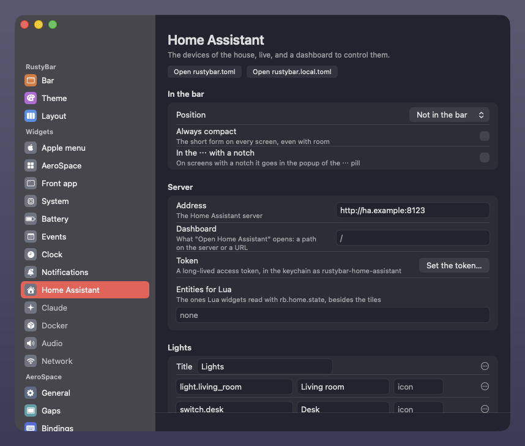</p>

A change is written at once, in place: comments, order and formatting stay as they were, a value
set back to its default goes away, and RustyBar's go to `rustybar.local.toml` when that's where the
key, or its table, already is. Then it's applied: the bar reloads by itself, AeroSpace is asked
to reload its config (its errors show at the bottom of the window), `borders` gets its new options,
SwipeAeroSpace reloads by itself, and MiddleClick has a button to restart it. A file that doesn't
parse is shown, and nothing is written to it until it's fixed.

The window runs in a process of its own, which ends when it closes: AppKit's controls leave some
35 MB behind in a process even after their window has gone, and the bar stays as light as it was.
`rustybar msg settings <page>` opens it on a page (`bar`, `theme`, `layout`, `widget:<name>`,
`aerospace`, `gaps`, `keys`, `monitors`, `rules`, `borders`, `swipe`, `middleclick`, `brew`).

## Made-up data

With `RUSTYBAR_MOCK` set to a folder, every widget but the clock reads `<folder>/<widget>.json`
instead of your Mac, and their actions do nothing, for screenshots and demos.
[examples/mock](examples/mock) has one file for each, and the settings window edits the configs in
[examples/mock/settings](examples/mock/settings) and applies nothing. AppKit's own flags pick
another language:

```bash
RUSTYBAR_MOCK=examples/mock target/release/rustybar -AppleLanguages '(en)' -AppleLocale en_US
```

`scripts/screenshots.py` takes the screenshots above from a bar started this way.

## Command line

```
rustybar msg reload                  reload the config
rustybar msg query                   the widgets, their state, where they are and which gave way
rustybar msg trigger <event> k=v…    send an event to every widget (Lua: event(self, name, args))
rustybar msg popup <widget>          open or close a popup
rustybar msg peek <widget>           grow a pill with its quick controls, as under the mouse, or back
rustybar msg settings [page]         open the settings window, on a page
rustybar settings [page]             the same, without the bar
rustybar msg quit
rustybar secret set home-assistant   save the Home Assistant token, read from stdin, in the keychain
```

For example, AeroSpace bindings that move windows can run
`rustybar msg trigger aerospace_windows` so the workspaces update at once.

## License

MIT
